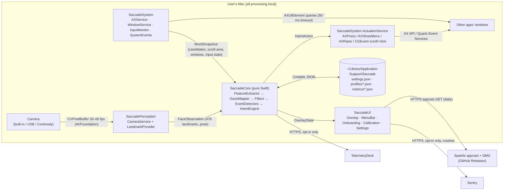
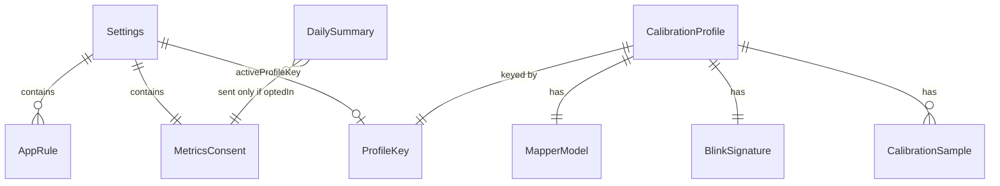
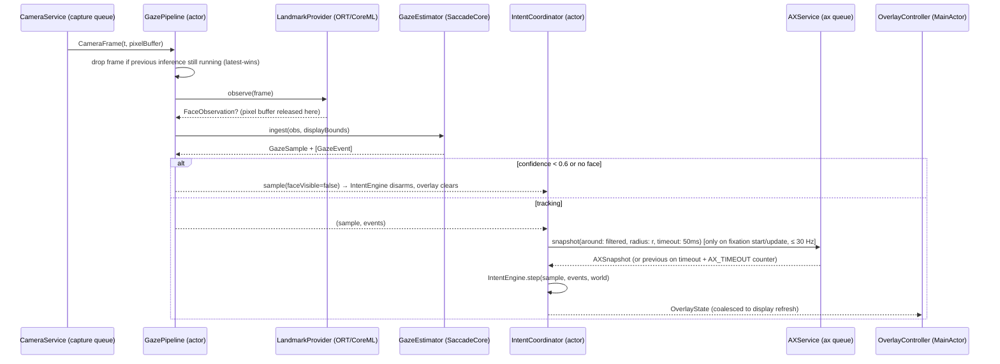
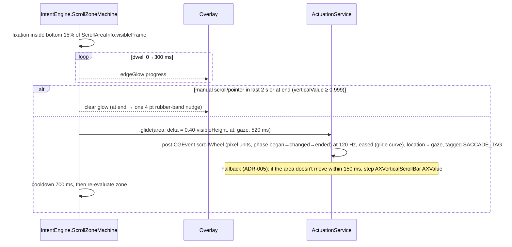

# Saccade — Architecture

> Version: 1.0 · Updated: 2026-11-03 · Source of truth for how Saccade fits together. If code and this doc disagree, fix one of them in the same PR and record an ADR (§16).

## 1. System Overview

Saccade is a single, non-sandboxed, Developer ID–signed macOS menu-bar app. A perception pipeline turns camera frames into gaze estimates and eye events entirely on-device (camera → face/iris landmarks on the Neural Engine → features → calibrated mapper → filters → events). A pure-Swift **intent engine** combines those events with a snapshot of the UI under the gaze, read through the macOS Accessibility (AX) API, and decides on actions: snap, click, scroll, focus, or reading marker. A **system layer** performs the actions with AX actions or synthetic `CGEvent`s, and a click-through **overlay** renders the highlight. The only network traffic is Sparkle update checks and, if the user opts in, TelemetryDeck/Sentry.



## 2. Tech Stack

Pinned versions, verified 2026-11-03 (P0.T1). Rule: pin the newest release that is at least 14 days old. Exact pins live in `project.yml` / `Package.swift` / `scripts/install-tools.sh`; update this table when they change.

| Layer | Choice | Version | Rationale |
|---|---|---|---|
| Language | Swift, language mode 6 (strict concurrency) | 6.4 (CI Linux image `swift:6.4.1-noble`; `swift-tools-version: 6.0`) | Native APIs (AVFoundation, AX, Quartz, Core ML) with data-race safety. |
| IDE / toolchain | Xcode | 27.1+ (dev Mac must run macOS 26.6+) | macOS 27 SDK, Swift 6.4, Swift Testing, SwiftUI shaders, `glassEffect`. |
| Min OS / hardware | macOS 14.0, Apple Silicon only | — | Neural Engine for latency/energy; `@Observable`, SwiftUI `MenuBarExtra`, shader effects. |
| UI | SwiftUI + AppKit bridges (`NSPanel`, `NSStatusItem`) | — | SwiftUI for all views; AppKit only for window levels, click-through overlay, status item geometry. |
| Glass material | `glassEffect()` on macOS 26+, `.ultraThinMaterial`/`NSVisualEffectView` fallback on 14–15 | — | Apple-native liquid glass where available, graceful fallback. |
| Shaders | SwiftUI `layerEffect`/`colorEffect` with Metal `.metal` files | — | Saccade bloom, specular sweep, and flare at 120 Hz on the GPU. |
| Camera | AVFoundation `AVCaptureSession` | — | Native, supports Continuity Camera. |
| Landmarks (primary) | MediaPipe Face Landmarker models (face detector + 478-pt landmarks incl. iris + blendshapes), converted to ONNX, run with ONNX Runtime + Core ML EP | ORT 1.24.2 (`onnxruntime-swift-package-manager`) | Iris landmarks + blink blendshapes; Apache-2.0 models; ANE acceleration. Decided in ADR-002. |
| Landmarks (fallback) | Apple Vision `VNDetectFaceLandmarksRequest` (revision 3) + `VNDetectFaceRectanglesRequest` (yaw/pitch/roll) | — | Zero-dependency fallback; selected automatically if the ORT provider fails to load. |
| Math | Hand-written small linear algebra in SaccadeCore (Cholesky ridge solve, ≤ 64×64) | — | Must compile on Linux (no Accelerate) for agent/CI testing. |
| Global hotkey | `sindresorhus/KeyboardShortcuts` | 3.1.0 | Battle-tested recorder UI + Carbon hotkeys; MIT. |
| Launch at login | `SMAppService.mainApp` | — | Native, no helper app. |
| Updates | Sparkle | 2.10.0 | De facto Mac updater, EdDSA-signed appcasts. |
| Metrics (opt-in) | TelemetryDeck SwiftSDK | 2.14.2 | Privacy-first, anonymized, no server to run. |
| Crash reports (opt-in) | Sentry Cocoa SDK | 9.30.2 | Symbolicated crashes; PII off. |
| Project generation | XcodeGen (`project.yml`) | 2.46.0 | Agents edit YAML, never `project.pbxproj`. |
| Packages | Swift Package Manager (local packages `Packages/SaccadeCore`, `Packages/SaccadeKit`) | — | Modular, testable with `swift test`; SaccadeCore also on Linux. |
| Tests | Swift Testing (`import Testing`) for units; XCTest/XCUITest for UI; `pointfreeco/swift-snapshot-testing` for view snapshots | 1.19.6 | Modern test macros; snapshot tests for visual regressions. |
| Lint / format | SwiftLint (strict) + SwiftFormat | SwiftLint 0.65.1, SwiftFormat 0.63.1 | Consistent style, enforced in CI. |
| Model conversion | Python 3.12 via `uv`, `tf2onnx`, `onnx`, `onnxruntime` (scripts only, not shipped) | — | Reproducible `Models/` artifacts with checksums. |
| DMG | `create-dmg` (npm or brew) | — | Branded drag-to-install DMG. |
| CI | GitHub Actions: `ubuntu-24.04` (container `swift:6.4.1-noble`) + `macos-26` (Xcode 27.1) | — | Linux job tests SaccadeCore cheaply; macOS job builds/tests the app. |

## 3. Component Boundaries

Package layout: two local SwiftPM packages. `Packages/SaccadeCore` is cross-platform (macOS + Linux) and holds `SaccadeCore`, `saccade-eval` and their tests. `Packages/SaccadeKit` is macOS-only, depends on SaccadeCore by path, and holds `SaccadePlatform`, `SaccadePerception`, `SaccadeSystem`, `SaccadeServices`, `SaccadeUI`, `SaccadeRuntime` and their tests. The Xcode app target `Saccade` (`App/`) is the composition root.

| Component | Responsibility | Owns | Exposes | Depends on | Must NOT |
|---|---|---|---|---|---|
| **SaccadeCore** | All pure logic: geometry, landmark → feature extraction, gaze mapping, filters, fixation/blink detection, blink grammar, snap scoring, scroll/focus/reading state machines, `IntentEngine`, settings models + migrations, trace format, telemetry schema & aggregation | Algorithm state; no I/O | `IntentEngine`, `GazeEstimator`, `FeatureExtractor`, `GazeMapper`, `BlinkGrammar`, models (§4), `Clock` protocol | Foundation only | Import AppKit, AVFoundation, ApplicationServices, Vision, CoreML, SwiftUI; read wall-clock time directly (use injected `Clock`); do file or network I/O. Must compile on Linux. |
| **SaccadePerception** | Camera capture, landmark providers, frame-rate control, `GazePipeline` actor, `TraceRecorder` (debug) | `AVCaptureSession`, ORT session, current `FaceObservation` | `GazePipeline.samples: AsyncStream<GazeSample>`, `LandmarkProvider` protocol | SaccadeCore, AVFoundation, Vision, onnxruntime | Retain pixel buffers past one inference; write images anywhere; touch AX or UI. |
| **SaccadeSystem** | Accessibility queries, window list, actuation (AX actions, CGEvents), input monitoring, permissions, system events (lock/sleep/display changes) | `AXUIElement` registry (`AXElementRef` ↔ `AXUIElement`), event taps/monitors | `AXService`, `WindowService`, `ActuationService`, `InputMonitor`, `PermissionsService`, `SystemEvents` | SaccadeCore, ApplicationServices, AppKit, CoreGraphics | Decide *whether* to act (only the IntentEngine decides); log AX string values at `.public`; read `AXValue` of secure text fields; post keyboard events. |
| **SaccadeServices** | Persistence (settings, profiles, metrics queue), telemetry sending, crash reporter wrapper | Files under Application Support | `SettingsStore`, `ProfileStore`, `MetricsQueue`, `TelemetryClient`, `CrashReporter` | SaccadeCore, TelemetryDeck, Sentry | Send anything when `MetricsConsent.state != .optedIn`; send fields not in the schema allowlist (§8). |
| **SaccadeUI** | All SwiftUI views & AppKit window controllers: overlay, menu bar popover, onboarding, calibration, settings, HUD, Eval Arena (DEBUG) | View state only | Window controllers + views; `DesignTokens` | SaccadeCore (models), SwiftUI, AppKit | Contain business rules (thresholds, gating); call AX/CGEvent directly; use raw colors/durations (tokens only). |
| **SaccadePlatform** | macOS shared kernel: `SaccadeLog` (os.Logger categories), `SaccadeSignposts`, `SystemClock`, `AppPaths` | — | those types | SaccadeCore, os | Contain domain logic; import SwiftUI/AppKit. |
| **SaccadeRuntime** | Orchestration actors: `IntentCoordinator` (perception stream + AX snapshots + input → `IntentEngine` → actions/overlay), `CalibrationCoordinator` (drives the pure `CalibrationSession`, persists profiles), `TrackingController` (on/off, camera start/stop, pause, system events, frame-rate modes), `SilentLearnerService` | Runtime wiring state | Coordinators consumed by SaccadeUI models via protocols | SaccadeCore, SaccadePerception, SaccadeSystem, SaccadeServices | Contain thresholds or decision logic (that's SaccadeCore); import SwiftUI. |
| **SaccadeEval** (library) + **saccade-eval** (thin executable) | Replay traces through SaccadeCore and report metrics; the library holds the logic so it is unit-testable | — | `SaccadeEval.run(arguments:output:)`, CLI | SaccadeCore | Depend on macOS frameworks (must run on Linux CI). |
| **Saccade** (app target) | Composition root: builds `AppEnvironment` (instantiates the SaccadeRuntime coordinators and SaccadeUI controllers), Sparkle `SPUStandardUpdaterController`, KeyboardShortcuts registration, app lifecycle | Object graph | `@main SaccadeApp` | All modules, Sparkle, KeyboardShortcuts | Contain algorithms, coordinators, or view code beyond wiring. |

`IntentCoordinator` (SaccadeRuntime, an actor) is the only place that combines the async perception stream with async AX snapshots and calls `IntentEngine.step(...)`, then dispatches actions to `ActuationService` and overlay state to the UI.

## 4. Data Model

There is no database. Persistent entities are Codable JSON files written atomically (`Data.write(options: .atomic)`) under `~/Library/Application Support/Saccade/`. Runtime entities live in memory only.

**Conventions**

- IDs: `UUID` (v4, Foundation) as `id`.
- Timestamps: persisted as ISO-8601 UTC strings (`Date` + `.iso8601` strategy); in-memory monotonic time is `TimeInterval` seconds from the injected `Clock` (`mach_continuous_time`-based in production).
- Coordinates: **global display points, top-left origin** (Quartz/AX convention). Convert to AppKit bottom-left only inside SaccadeUI window code via `ScreenGeometry.toAppKit(_:)`.
- Every file has `schemaVersion: Int`. `SettingsMigrator` / `ProfileMigrator` upgrade step by step (`v1→v2`, …). Shipped migration steps are never edited; add a new step. If a file is unreadable: rename it to `<name>.corrupt-<ISO date>.json`, load defaults, and show a HUD notice once.



### Settings (`settings.json`)

| Field | Type | Constraints / default | Notes |
|---|---|---|---|
| schemaVersion | Int | = 1 | |
| isEnabled | Bool | default true | last on/off state (F-10) |
| onboarding | `OnboardingProgress` enum: `notStarted`,`camera`,`accessibility`,`calibrate`,`playground`,`completed` | default `notStarted` | F-01.AC4 resume |
| (hotkey) | — | — | not in `Settings`: fixed ⌃⌥S via Carbon `RegisterEventHotKey`; a rebindable KeyboardShortcuts recorder is planned |
| launchAtLogin | Bool | default false | `SMAppService` state is the source of truth; this mirrors the user's intent |
| gazeDisplayUUID | String? | nil = display containing camera / main display | `CGDisplayCreateUUIDFromDisplayID` |
| cameraUniqueID | String? | nil = first front-facing / built-in | `AVCaptureDevice.uniqueID` |
| activeProfileKey | ProfileKey? | nil | |
| click | `ClickSettings` | see below | |
| scroll | `ScrollSettings` | see below | |
| focusFollowsGaze | `FocusSettings` | `{enabled: true, dwellMs: 900}` dwellMs ∈ 600…1500 | F-08 |
| readingMarkerEnabled | Bool | true | F-09 |
| silentLearningEnabled | Bool | true | F-04 |
| preciseTargetsOnly | Bool | true | F-05: disables clicks in no-AX regions |
| clickSound | Bool | false | Q4 |
| appRules | [AppRule] | default list (F-10) | |
| metricsConsent | MetricsConsent | `{state: neverAsked}` | |
| pausedUntil | Date? | nil | timed pause |
| debugGazeDot | Bool | false | Advanced |
| demoCaptureMode | — | not persisted | in-memory only; always false at launch (F-11.AC6) |

`ClickSettings`: `{enabled: Bool = true, sensitivity: Double = 0.5 (0…1, maps to closure threshold ±0.1 and gap window ±60 ms), rightClickEnabled: Bool = true}`
`ScrollSettings`: `{enabled: Bool = true, downZoneFraction: Double = 0.15 (0.10…0.25), upZoneFraction: Double = 0.10 (0.05…0.20), glideFraction: Double = 0.40 (0.25…0.60), dwellMs: Int = 300 (200…600)}`

### AppRule

| Field | Type | Constraints | Notes |
|---|---|---|---|
| bundleID | String | unique in list, non-empty | e.g. `com.1password.1password` |
| mode | `AppRuleMode` enum: `off`, `scrollOnly` | default `off` | |
| isDefault | Bool | | defaults can be removed but are restored by "Reset to defaults" |

Default rules: `com.1password.1password`, `com.agilebits.onepassword7`, `com.bitwarden.desktop`, `com.apple.keychainaccess`, `com.apple.loginwindow`, `com.apple.ScreenSaver.Engine`, `com.apple.systempreferences`: all `off`.

### MetricsConsent

| Field | Type | Notes |
|---|---|---|
| state | enum `neverAsked`, `optedIn`, `optedOut` | |
| changedAt | Date? | |
| installID | UUID | random per install, regenerated on opt-out→opt-in and on "Delete all data"; TelemetryDeck hashes it again |

### ProfileKey

| Field | Type | Notes |
|---|---|---|
| cameraUniqueID | String | |
| displayUUID | String | |
File name: `profiles/<sha256(cameraUniqueID + "|" + displayUUID) prefix 16>.json`.

### CalibrationProfile (`profiles/*.json`)

| Field | Type | Constraints | Notes |
|---|---|---|---|
| schemaVersion | Int | = 1 | |
| id | UUID | | |
| key | ProfileKey | unique per file | |
| createdAt / updatedAt | Date | | |
| displaySizePt | Size | | for normalization; recalibration prompted if changed |
| validationMedianErrorDeg | Double | ≥ 0 | drives the accuracy chip |
| level | enum `excellent`,`good`,`fair`,`poor` | derived from error (PRD F-03) | |
| mapper | MapperModel | | |
| blink | BlinkSignature | | |
| samples | [CalibrationSample] | explicit ≤ 400, implicit ≤ 400 | FIFO for implicit |

### CalibrationSample

| Field | Type | Notes |
|---|---|---|
| t | Date | capture time |
| kind | enum `explicit`, `implicit` | |
| features | [Double] (length = `GazeFeatures.dimension` = 14) | numeric only |
| target | Point (pt, global) | anchor or click location |
| weight | Double | explicit 1.0; implicit 0.5 × decay at fit time |

### MapperModel

| Field | Type | Notes |
|---|---|---|
| featureVersion | Int | bump when the `FeatureExtractor` layout changes → profile needs recalibration |
| mean / std | [Double] | feature standardization |
| coefX / coefY | [Double] | ridge coefficients over the expanded basis (§10) |
| lambda | Double | chosen by LOO |
| residualSigmaPt | Double | 1σ residual on validation; base of `sigmaPt` |
| poseCentroid / poseCovInv | [Double] | head-pose distribution of the training samples for uncertainty inflation |

### BlinkSignature

| Field | Type | Default | Notes |
|---|---|---|---|
| openEAR | Double | measured | per-user open eye aspect ratio (mean of both eyes) |
| closedEAR | Double | measured | |
| closureThreshold | Double | 0.6 | normalized closure ≥ threshold = closed |
| deliberateMinDepth | Double | 0.8 | intended blinks are deeper |
| gapMsRange | [Int, Int] | [80, 450] | tuned from the user's double blink |

### DailySummary (`metrics/summary-YYYY-MM-DD.json`; queued only if opted in)

| Field | Type | Notes |
|---|---|---|
| day | String `YYYY-MM-DD` | local date |
| trackingMinutes | Int | |
| clicks / rightClicks / scrolls / focusSwitches / readingMarkers | Int | |
| clickRevertProxy | Int | ⌘Z / Esc / ⌘[ within 3 s after a gaze click |
| rejectedDoubleBlinks | Int | |
| p95LatencyMsBucket | enum `"30"`,`"50"`,`"80"`,`"120"`,`"inf"` | |
| meanSigmaPtBucket | enum `"40"`,`"80"`,`"120"`,`"inf"` | |
| axTimeouts | Int | |
| provider | enum `mediapipe`,`vision` | |
| appVersion / osMajor / chip | String enum-like | `chip` ∈ `M1`,`M2`,`M3`,`M4`,`M5`,`other` |

### Runtime (in-memory only)

| Entity | Fields | Producer → Consumer |
|---|---|---|
| `FaceObservation` | `t`, `landmarks: [Point3]` (478, normalized image coords), `blendshapes: [String: Float]?`, `faceTransform: [Float]` (4×4)?, `confidence: Float`, `imageSize` | LandmarkProvider → FeatureExtractor |
| `GazeFeatures` | 14 doubles: `irisL.x, irisL.y, irisR.x, irisR.y` (iris center in eye-corner frame, ∈ ~[-1,1]), `yaw, pitch, roll` (rad), `faceX, faceY` (normalized), `faceScale` (inter-ocular px / image width), `earL, earR`, `closureL, closureR` | FeatureExtractor → GazeMapper, BlinkDetector |
| `GazeSample` | `t`, `raw: Point`, `filtered: Point`, `sigmaPt`, `confidence`, `closureL/R`, `faceVisible`, `onScreen` | GazeEstimator → IntentCoordinator |
| `GazeEvent` | enum: `.fixationStarted(Fixation)`, `.fixationUpdated(Fixation)`, `.fixationEnded(Fixation)`, `.saccade(from,to)`, `.blink(Blink)`, `.faceLost`, `.faceFound`, `.offScreen`, `.onScreen` | Event detectors → IntentEngine |
| `Fixation` | `id`, `start`, `duration`, `center: Point`, `dispersionPt`, `meanFeatures` | |
| `Blink` | `start`, `end`, `depth`, `symmetric: Bool` | |
| `TargetCandidate` | `ref: AXElementRef`, `role`, `frame: Rect`, `actions: Set<AXActionName>`, `isSecure: Bool`, `isEnabled`, `appBundleID`, `pid` | AXService → SnapScorer |
| `ScrollAreaInfo` | `ref`, `visibleFrame`, `verticalValue: Double?` (0…1), `canScrollUp/Down` | AXService |
| `WindowInfo` | `windowID: CGWindowID`, `pid`, `bundleID`, `frame`, `isFocused` | WindowService |
| `WorldSnapshot` | `t`, `candidates`, `scrollArea`, `windowUnderGaze`, `focusedWindow`, `secondsSinceKeyDown`, `mouseButtonDown`, `lastPhysicalPointerMoveT`, `lastPhysicalScrollT`, `frontAppRule`, `statusItemFrame`, `lineRect: Rect?` | IntentCoordinator → IntentEngine |
| `IntentAction` | enum: `.press(AXElementRef, fallbackPoint)`, `.showMenu(AXElementRef, fallbackPoint)`, `.glide(ScrollAreaRef, deltaPt, at: Point, durationMs)`, `.focus(WindowInfo)`, `.setPaused(Bool)`, `.markLine(Rect)`, `.manualAccessibility(pid)` | IntentEngine → ActuationService / UI |
| `OverlayState` | `saccade: SaccadeVisual?` (`frame`, `phase`: `.acquiring/.locked/.armed/.uncertain(second: Rect)/.flare/.reject`), `aura: (center, radius)?`, `edgeGlow: (rect, edge, progress)?`, `lineMarker: Rect?`, `windowFlash: Rect?`, `debugDot: Point?` | IntentEngine → OverlayController |

**Indexes / lookups:** `ProfileStore` keeps an in-memory dictionary `[ProfileKey: CalibrationProfile]`. `AXService` keeps an LRU of `AXElementRef → AXUIElement` (max 512, cleared on app switch).

**Deletion:** "Delete all data" removes the Application Support folder, KeyboardShortcuts UserDefaults keys, and the Sentry/TelemetryDeck caches (`TelemetryDeck` cache dir; `SentrySDK.close()` + its cache path).

## 5. Internal API & Event Contracts

Saccade has no HTTP API. Its "API" is the set of Swift protocols between modules plus three outbound network integrations (§8). Contracts below are normative: names and signatures must match.

### 5.1 Module protocols

```swift
// SaccadeCore
public protocol Clock: Sendable { func now() -> TimeInterval }

public protocol LandmarkProviding: Sendable {            // implemented in SaccadePerception
  var kind: LandmarkProviderKind { get }                 // .mediapipe | .vision
  func observe(_ frame: CameraFrame) async throws -> FaceObservation?   // nil = no face
}

public struct GazeEstimator {                            // pure, value type
  public init(mapper: MapperModel?, filter: OneEuroConfig, clock: Clock)
  public mutating func ingest(_ obs: FaceObservation?, displayBounds: Rect) -> (GazeSample, [GazeEvent])
}

public struct IntentEngine {                             // pure, value type, deterministic
  public init(settings: Settings, blink: BlinkSignature, clock: Clock)
  public mutating func step(sample: GazeSample, events: [GazeEvent], world: WorldSnapshot)
      -> (actions: [IntentAction], overlay: OverlayState, diagnostics: IntentDiagnostics)
  public mutating func update(settings: Settings)
}

public enum GazeMapperFitter {
  public static func fit(samples: [CalibrationSample], now: Date) throws(SaccadeError) -> MapperModel
  public static func looError(_ model: MapperModel, samples: [CalibrationSample]) -> Double
}
```

```swift
// SaccadeSystem
public protocol AXServicing: Sendable {
  func snapshot(around p: Point, radius: Double, timeout: Duration) async -> AXSnapshot   // candidates + scroll area + lineRect
  func setManualAccessibility(pid: pid_t) async
  func perform(_ action: AXActionName, on ref: AXElementRef) async throws(SaccadeError)
  func scrollValue(of ref: AXElementRef) async -> Double?
}
public protocol WindowServicing: Sendable {
  func window(at p: Point) -> WindowInfo?
  func focusedWindow() -> WindowInfo?
  func raise(_ w: WindowInfo) async throws(SaccadeError)
}
public protocol ActuationServicing: Sendable {
  func execute(_ action: IntentAction) async -> ActuationResult      // .done | .fallbackUsed | .failed(SaccadeError)
}
public protocol InputMonitoring: Sendable {
  var physicalClicks: AsyncStream<PhysicalClick> { get }            // excludes events with Saccade's sourceUserData tag
  var physicalActivity: AsyncStream<PhysicalActivity> { get }       // pointer moves > 4 pt, scroll, mouse down/up
  func secondsSinceLastKeyDown() -> TimeInterval                    // CGEventSource.secondsSinceLastEventType
}
public protocol PermissionsServicing: Sendable {
  func camera() -> PermissionState          // .notDetermined | .granted | .denied | .restricted
  func requestCamera() async -> PermissionState
  func accessibility() -> PermissionState    // AXIsProcessTrusted
  func promptAccessibility()                 // AXIsProcessTrustedWithOptions(prompt: true)
}
```

```swift
// SaccadeServices
public protocol SettingsStoring: Sendable {
  func load() -> Settings
  func save(_ s: Settings) throws(SaccadeError)
  var changes: AsyncStream<Settings> { get }
}
public protocol ProfileStoring: Sendable {
  func profile(for key: ProfileKey) -> CalibrationProfile?
  func save(_ p: CalibrationProfile) throws(SaccadeError)
  func deleteAll() throws(SaccadeError)
}
public protocol TelemetryClienting: Sendable {
  func signal(_ s: TelemetrySignal) async      // no-op unless optedIn; TelemetrySignal is a closed enum (§8)
}
```

### 5.2 Event & action catalogue

| Producer | Event / call | Payload | Consumer | Feature |
|---|---|---|---|---|
| CameraService | `frames: AsyncStream<CameraFrame>` | `CVPixelBuffer` (not Sendable-escaped; wrapped, dropped after use), `t` | GazePipeline | F-02 |
| GazePipeline | `samples: AsyncStream<(GazeSample, [GazeEvent])>` | see §4 | IntentCoordinator, CalibrationCoordinator | F-02 |
| InputMonitor | `physicalClicks` | `PhysicalClick {t, location, button}` | SilentLearner | F-04 |
| InputMonitor | `physicalActivity` | `.pointerMoved / .scrolled / .buttonDown / .buttonUp` with `t` | IntentCoordinator | F-07, F-10 |
| SystemEvents | `events` | `.screenLocked/.unlocked/.willSleep/.didWake/.displaysChanged/.sessionResigned/.sessionActive` | AppEnvironment | F-10 |
| IntentEngine | `IntentAction` | §4 | ActuationService / OverlayController / PauseController | F-05–F-10 |
| IntentEngine | `OverlayState` | §4 | OverlayController (MainActor, display link) | F-05, F-07, F-09 |
| CalibrationCoordinator (wrapping SaccadeCore `CalibrationSession`) | `CalibrationProgress` | `.waitingForDoubleBlink/.anchor(i, progress)/.faceLost/.validating(i)/.result(level, errorDeg)/.failed(reason)` | CalibrationView | F-03 |
| SilentLearner | `modelUpdated(MapperModel)` | | GazePipeline (atomic swap) | F-04 |

### 5.3 Error catalogue (`SaccadeError`)

`SaccadeError` is a single `enum` in SaccadeCore (`Error, Equatable, Sendable`) with a stable `code: String` used in logs, diagnostics export and (bucketed) telemetry.

| Code | Case | Raised by | User-facing surface | Recovery |
|---|---|---|---|---|
| `CAMERA_PERMISSION_DENIED` | `.cameraPermissionDenied` | PermissionsService | Onboarding denied state / popover banner | Open System Settings |
| `CAMERA_RESTRICTED` | `.cameraRestricted` | PermissionsService | "Your organization blocks camera access" | None |
| `AX_PERMISSION_MISSING` | `.accessibilityNotTrusted` | PermissionsService, AXService | Banner "Saccade can't act — Accessibility is off" | Deep link + relaunch prompt |
| `CAMERA_NOT_FOUND` | `.cameraNotFound` | CameraService | "Connect a camera or turn on Continuity Camera" | Auto-retry on device connect notification |
| `CAMERA_INTERRUPTED` | `.cameraInterrupted(reason)` | CameraService | HUD "Camera paused by macOS" | Auto-restart with backoff 0.5/1/2 s, then every 5 s |
| `MODEL_LOAD_FAILED` | `.modelLoadFailed(provider)` | LandmarkProvider | Silent fallback to Vision; if both fail, popover "Saccade couldn't start its vision engine. Reinstall Saccade." | Fallback provider |
| `MODEL_CHECKSUM_MISMATCH` | `.modelChecksumMismatch` | ModelLoader | same as above | Refuse to load (G-SEC-08) |
| `NOT_CALIBRATED` | `.notCalibrated` | IntentCoordinator | Popover chip "Not calibrated" + Calibrate CTA | Run F-03 |
| `CALIBRATION_INSUFFICIENT` | `.calibrationInsufficient(anchorsOK: Int)` | CalibrationSession | Failed state copy | Retry |
| `MAPPER_SINGULAR` | `.mapperSingular` | GazeMapperFitter | none (keep old model) | Increase lambda ×10, retry once |
| `AX_TIMEOUT` | `.axTimeout` | AXService | none (diagnostics counter) | Keep previous snapshot |
| `AX_ACTION_UNSUPPORTED` | `.axActionUnsupported(action)` | AXService | none | ActuationService uses CGEvent fallback |
| `AX_ELEMENT_GONE` | `.axElementInvalid` | AXService | saccade reject shake | Drop lock |
| `ACTUATION_FAILED` | `.actuationFailed` | ActuationService | saccade reject shake | none |
| `SETTINGS_CORRUPT` | `.settingsCorrupt` | SettingsStore | HUD once "Settings were reset" | Backup + defaults |
| `PERSISTENCE_FAILED` | `.persistenceFailed` | Stores | HUD "Couldn't save — check disk space" | Retry on next change |
| `UPDATE_FAILED` | (Sparkle-owned) | Sparkle | Only on manual check (Sparkle UI) | Sparkle retries |

## 6. Data Flows

### 6.1 Frame → gaze → overlay (every frame)



### 6.2 Double-blink click (F-06)

```mermaid
sequenceDiagram
  participant U as User
  participant E as IntentEngine
  participant G as BlinkGrammar
  participant Act as ActuationService
  participant AX as AXService
  participant O as Overlay
  U->>E: fixation on "Next →" ≥ 250 ms (lock stable, not uncertain)
  E-->>O: saccade .locked
  U->>G: blink 1 (closure ≥ thr, 50–350 ms)
  G-->>E: .firstBlink → freeze lock target
  E-->>O: saccade .armed
  U->>G: blink 2 within gap 80–450 ms
  G-->>E: .doubleBlink(pattern ≤ 900 ms)
  E->>E: wait ≤ 300 ms for gaze reopen within max(1.5σ, 40pt) of frozen target
  alt gaze returned & not paused & app allowed & no mouse button down
    E->>Act: .press(ref, fallbackPoint)
    Act->>AX: AXUIElementPerformAction(kAXPressAction)
    alt success
      AX-->>Act: .success
    else AX_ACTION_UNSUPPORTED / failure
      Act->>Act: save cursor; CGEvent leftMouseDown/Up at fallbackPoint (sourceUserData = SACCADE_TAG); restore cursor
    end
    Act-->>E: ActuationResult
    E-->>O: saccade .flare (260 ms) then cooldown 500 ms
  else gate fails
    E-->>O: saccade .reject (2 pt shake)
  end
```

### 6.3 Glide scroll (F-07)



### 6.4 Calibration and silent learning (F-03, F-04)

```mermaid
sequenceDiagram
  participant CV as CalibrationView
  participant CC as CalibrationCoordinator (+ CalibrationSession)
  participant P as GazePipeline
  participant F as GazeMapperFitter
  participant S as ProfileStore
  participant IM as InputMonitor
  participant SL as SilentLearner
  CV->>CC: start()
  CC->>P: raw features stream (mapper bypassed)
  CC-->>CV: .waitingForDoubleBlink
  P-->>CC: blink events → BlinkSignature (open/closed EAR, gaps)
  loop 13 anchors
    CC-->>CV: .anchor(i) (saccade glides there, pauses 1.2 s)
    P-->>CC: features (skip first 300 ms; discard if faceVisible=false)
  end
  CC->>F: fit(explicit samples)
  F-->>CC: MapperModel (or MAPPER_SINGULAR → retry λ×10)
  loop 5 validation points
    CC-->>CV: .validating(i)
  end
  CC->>CC: median angular error → level
  alt anchorsOK ≥ 6
    CC->>S: save(profile) ; P.swap(mapper)
    CC-->>CV: .result(level, errorDeg)
  else
    CC-->>CV: .failed(.calibrationInsufficient)
  end
  IM-->>SL: PhysicalClick(location)
  SL->>SL: accept/reject (PRD F-04 rules) ; every 20 accepted → background fit
  SL->>F: fit(explicit + implicit weighted)
  alt LOO not worse than +5%
    SL->>S: save ; SL->>P: swap(mapper)
  end
```

### 6.5 Opt-in telemetry

```mermaid
sequenceDiagram
  participant Agg as MetricsAggregator (SaccadeCore)
  participant Q as MetricsQueue
  participant T as TelemetryClient
  participant TD as TelemetryDeck
  Agg->>Q: at local midnight or on quit: DailySummary (only if optedIn)
  Q->>Q: validate against TelemetrySchema allowlist (reject on unknown field)
  Q->>T: send pending (≤ 7 days)
  T->>TD: SDK signal "dailySummary" with enum/int params
  alt network failure
    T-->>Q: keep pending; retry next launch/day
  end
```

## 7. Frontend Architecture

All UI is in SaccadeUI; windows are created by controllers owned by `AppEnvironment`.

| Surface | Type | Shown when | Data source | Calls | Feature |
|---|---|---|---|---|---|
| Menu bar item + popover | `MenuBarExtra(.window)` with custom label view | always | `AppModel` (`@Observable`): `trackingState`, `accuracyLevel`, `permissionBanners`, `pauseState` | `AppModel.toggle()`, `.pause(for:)`, `.recalibrate()`, `.openSettings()` | F-10, F-11 |
| Overlay (F-13: AX-hidden, capture-excluded) | Borderless `NSPanel`, one per gaze display: `level = .statusBar + 1`, `ignoresMouseEvents = true`, `collectionBehavior = [.canJoinAllSpaces, .fullScreenAuxiliary, .stationary, .ignoresCycle]`, `hasShadow = false`, `backgroundColor = .clear`, `sharingType = .none` (never appears in screenshots/recordings; `.readOnly` only while the session-scoped Demo capture mode is on, F-11.AC6) | tracking & not paused | `OverlayState` stream | none (render only) | F-05, F-06, F-07, F-08, F-09 |
| Onboarding window | `Window` 720×520 fixed, glass | `onboarding != .completed` | `OnboardingModel` | PermissionsService, CalibrationCoordinoller, Playground | F-01 |
| Calibration | Full-screen borderless window on gaze display, `level = .screenSaver` | from onboarding or Recalibrate | `CalibrationProgress` | CalibrationCoordinator | F-03 |
| Playground | Section of onboarding window with practice article (scrollable) + 3 buttons | onboarding step 5 | static content | real IntentEngine | F-01 |
| Settings | `Settings` scene, tabbed, 640×480 | ⌘, or popover | `SettingsModel` bound to SettingsStore | SettingsStore, ProfileStore, PermissionsService, Updater | F-11, F-12 |
| HUD | Glass capsule `NSPanel` top-center of gaze display, auto-dismiss 2.4 s | state transitions (§DESIGN_SYSTEM 9.7) | `HUDCenter` queue (max 1 visible, coalesces duplicates) | none | F-02, F-10 |
| Eval Arena (DEBUG only) | Full-screen window with scenes | Debug menu | `ArenaModel` | TraceRecorder | F-15 |

**State strategy:** `@Observable` models on `@MainActor`, one per surface, fed by AsyncStreams from actors. No Combine in new code. Settings changes flow `View → SettingsModel → SettingsStore.save → changes stream → IntentCoordinator.update(settings:)`. URL/navigation state does not apply.

**Overlay rendering:** `OverlayController` subscribes to `OverlayState`, keeps the latest value, and renders on `NSView.displayLink(target:selector:)` ticks. Saccade position and size are animated by SwiftUI springs (DESIGN_SYSTEM §6). The specular sweep and flare are Metal shaders. The overlay never takes key or main window status.

## 8. Third-Party Integrations

| Integration | Purpose | Package | Auth | Config | Webhooks | Rate limits | Failure behavior | Local dev |
|---|---|---|---|---|---|---|---|---|
| **ONNX Runtime** | Run MediaPipe landmark models on ANE/GPU/CPU | `microsoft/onnxruntime-swift-package-manager` (product `onnxruntime`) | none | `Models/*.onnx` + `Models/checksums.sha256` | — | — | Load fails → Vision provider (`MODEL_LOAD_FAILED`) | Same models; `SACCADE_PROVIDER=vision` env forces fallback |
| **MediaPipe models** | face detector (short-range), face landmarks (478 incl. iris), blendshapes | Downloaded by `scripts/models/fetch_and_convert.py` from Google's MediaPipe model storage; converted with `tf2onnx` | — | Pinned URLs + SHA-256 in `scripts/models/manifest.json` | — | — | Checksum mismatch → refuse (G-SEC-08) | Converted ONNX committed via Git LFS |
| **Apple Vision** | Fallback landmarks | system | — | — | — | — | — | — |
| **Sparkle** | Auto-update (F-14) | `sparkle-project/Sparkle` 2.10.0 | EdDSA public key in Info.plist `SUPublicEDKey` | `SUFeedURL` (`SACCADE_SPARKLE_FEED_URL`), `SUEnableAutomaticChecks = YES`, `SUScheduledCheckInterval = 86400` | — | GitHub Releases | Silent retry; errors shown only on manual check | `SACCADE_SPARKLE_FEED_URL` → local `python3 -m http.server` serving a test appcast |
| **TelemetryDeck** | Opt-in metrics | `TelemetryDeck/SwiftSDK` 2.14.2 | App ID | `SACCADE_TELEMETRYDECK_APP_ID` | — | Free-tier signal quota; we send ≤ ~3 signals/user/day | Queue up to 7 days, then drop | `testMode` auto-enabled in DEBUG; or leave App ID empty → client is a no-op |
| **Sentry** | Opt-in crash reports | `getsentry/sentry-cocoa` 9.30.2 | DSN | `SACCADE_SENTRY_DSN`; options: `sendDefaultPii = false`, `attachScreenshot = false`, `attachViewHierarchy = false`, `enableAutoBreadcrumbTracking = false`, `beforeSend` scrubber | — | Sentry plan quota | Never initialized unless opted in; init failure is ignored | Empty DSN → no-op |
| **KeyboardShortcuts** | Global hotkey + recorder | `sindresorhus/KeyboardShortcuts` 3.1.0 | — | Name `toggleSaccade` default ⌃⌥G | — | — | Registration conflict → Settings shows "Shortcut in use" | — |
| **GitHub Releases** | Host DMG + `appcast.xml` | `gh` CLI in release workflow | `GITHUB_TOKEN` (CI) | — | — | — | Release job fails loudly | — |
| **Homebrew tap** | `brew install --cask` | separate repo `homebrew-tap`, `Casks/saccade.rb` | `HOMEBREW_TAP_TOKEN` (CI) | — | — | — | Manual PR if the bot fails | — |

**TelemetrySignal allowlist (closed enum, the only things ever sent):**

| Signal | Parameters (all enum or Int) | When |
|---|---|---|
| `onboarding.started` | — | onboarding step 1 shown (sent only after opt-in; queued) |
| `onboarding.step` | `step` ∈ camera/accessibility/calibrate/playground, `outcome` ∈ granted/denied/skipped/done | step completes |
| `onboarding.completed` | `durationBucket` ∈ 60/120/300/inf (s) | |
| `calibration.completed` | `errorBucket` ∈ excellent/good/fair/poor, `anchorsOK` Int, `source` ∈ onboarding/recalibrate | |
| `calibration.failed` | `anchorsOK` Int | |
| `dailySummary` | fields of DailySummary (§4) | daily |
| `settings.changed` | `key` ∈ closed enum of setting names, `value` ∈ on/off/bucket | toggles only |

## 9. Background Jobs & Scheduling

In-process scheduled work only (no server).

| Job | Trigger | Payload | Idempotency | Retries / backoff | Timeout | Dead-letter |
|---|---|---|---|---|---|---|
| `SilentLearner.refit` | every 20 accepted implicit samples | snapshot of samples | runs on a copy; swap is atomic; one at a time (actor) | none (next trigger) | 2 s CPU budget, cancel if exceeded | log `refit.timeout` |
| `MetricsAggregator.rollover` | local midnight (`NSCalendarDayChanged`) and app quit | current counters | file per day (`summary-YYYY-MM-DD.json`) overwritten | — | — | — |
| `MetricsQueue.flush` | launch + 60 s, then every 6 h | pending summaries | TelemetryDeck dedupe not relied on; file deleted only after SDK accepts | next schedule | 10 s | drop files older than 7 days |
| `CameraService.restart` | interruption ended / device connected | — | single-flight | 0.5, 1, 2 s then every 5 s | — | HUD after 3 failures |
| `PauseController.resumeTimer` | `pausedUntil` | — | — | — | — | — |
| Sparkle check | daily (Sparkle-owned) | — | Sparkle | Sparkle | Sparkle | — |

## 10. ML / Perception Subsystem

Saccade has no LLMs. This section specifies the on-device perception and intent models.

### 10.1 Landmark providers

- **MediaPipeORTProvider** (default): (1) the face detector (short-range BlazeFace, 128×128 input) runs only when there is no face track or every 30th frame; (2) the landmark model (256×256 crop around the tracked face, rotation-normalized by eye line) → 478 landmarks (468 face + 10 iris); (3) the blendshape model (input: 146 selected landmarks) → 52 blendshapes, of which `eyeBlinkLeft/Right` and `eyeSquint*` are used. ORT session options: Core ML EP with `MLComputeUnits.all`, `ModelFormat=MLProgram`, static input shapes. Preprocessing uses vImage on the pixel buffer; the buffer is released immediately after the crop tensor is built.
- **VisionProvider** (fallback): `VNDetectFaceLandmarksRequest` (constellation 76-point) gives pupils + eye contours; head pose comes from `VNFaceObservation.yaw/pitch/roll`. Blink uses the eye aspect ratio from contours. Expected accuracy is lower; the provider kind is shown in Advanced → Diagnostics.
- Selection: `ModelLoader` verifies the SHA-256 of each `.onnx` file against `checksums.sha256`, creates the ORT session, and runs a warm-up inference. On failure it uses Vision and records `MODEL_LOAD_FAILED`. The `SACCADE_PROVIDER` env var (DEBUG only) forces a provider.

### 10.2 Features (`FeatureExtractor`, SaccadeCore)

For each eye: the eye-corner frame is defined by the inner/outer canthus landmarks (origin = midpoint, x-axis = corner→corner, scale = half corner distance). The iris center (mean of the 5 iris landmarks) is expressed in that frame → `irisL`, `irisR`. Head pose comes from the face transform matrix (MediaPipe) or Vision angles. `faceX/Y` = nose-bridge position normalized to image size; `faceScale` = inter-ocular distance / image width (depth proxy). EAR = (vertical lid distances) / (horizontal corner distance). Closure = `clamp((openEAR − EAR) / (openEAR − closedEAR), 0, 1)`, blended 50/50 with the blendshape `eyeBlink*` when available. Feature vector length = 14, `featureVersion = 1`.

### 10.3 Gaze mapper (`GazeMapper`, ridge regression)

- Basis expansion φ(x): `[1, irisL, irisR, irisL², irisR², irisL.x·irisL.y, irisR.x·irisR.y, yaw, pitch, roll, faceX, faceY, faceScale, irisL·faceScale, irisR·faceScale, yaw·irisL.x, pitch·irisL.y, yaw·irisR.x, pitch·irisR.y]` (≈ 30 terms), standardized.
- Separate ridge regressions for x and y, `λ ∈ {1e-4 … 1e1}` chosen by leave-one-out (closed form via the hat matrix), solved with Cholesky in SaccadeCore.
- Uncertainty: `sigmaPt = residualSigmaPt × (1 + 0.5 × mahalanobis(pose, poseCentroid, poseCovInv)) × (1 + 2 × (1 − confidence))`, clamped to [15, 300] pt.
- Angular conversion for metrics: the distance estimate comes from `faceScale` with an assumed 63 mm IPD and the camera FOV (default 70° diagonal, overridable per camera model table); the display pt→mm factor comes from `CGDisplayScreenSize`.

### 10.4 Filters & event detection

- **One Euro filter** on the mapped point for display: `minCutoff = 1.0 Hz`, `beta = 0.007`, `dCutoff = 1.0 Hz` (tuned in P2.T7).
- **Fixation detector (I-DT)**: window ≥ 100 ms, dispersion ≤ `max(1.2° in pt, 0.6·sigmaPt)` → fixation. It emits `fixationStarted`, then `fixationUpdated` at ≤ 30 Hz, then `fixationEnded`. Samples with closure > 0.5 are excluded from fixation math (eyelid occlusion biases the iris).
- **Saccade**: velocity > 30°/s between filtered samples.
- **BlinkDetector**: per frame, both-eyes closure ≥ `closureThreshold` for ≥ 2 frames and 50–350 ms → `Blink{depth, symmetric}`; 400–900 ms → long closure; > 900 ms → `eyesClosed` (rest, never an action).
- **BlinkGrammar**: a state machine over blinks: `idle → firstBlink → (doubleBlink | blinkLongBlink | timeout)` using `gapMsRange` and the 900 ms total pattern; requires `depth ≥ deliberateMinDepth` for both blinks when `sensitivity < 0.7`.

### 10.5 Intent engine (SaccadeCore, pure)

Sub-machines are stepped in this order on every sample: `PauseMachine` → `AppRuleGate` → `SnapMachine` (F-05) → `ClickMachine` (F-06) → `ScrollZoneMachine` (F-07) → `FocusDwellMachine` (F-08) → `ReadingTracker` (F-09) → `OverlayComposer`. Each is a `struct` with explicit `State` enum and transition tests. Thresholds live in `IntentConstants` (one file); settings override a documented subset.

### 10.6 Determinism & traces

**Session traces (as built, `saccade-trace/v2`).** With Settings → Advanced → Record sessions for tuning on, `TrackingController` emits `TraceRecord`s and `TraceWriter` (SaccadeServices) appends them as JSON Lines to `~/Library/Application Support/Saccade/traces/session-<time>.jsonl`, batched off the main thread and capped at 64 MB. Records: a header (format, feature version, screen size, points per degree), the mapper model (again after each recalibration), one frame per camera frame (`GazeFeatures` or null, confidence, face visible), and a label per click (truth, weight). There are no images, no landmarks of other apps and no screen content. `saccade-eval --trace <file>` replays a trace through the production `GazeEstimator` (`TraceReplay`, SaccadeCore) and reports median and p90 error at each label for the mapper, the stabilized and the corrected estimate, measured before learning from that label, exactly as live. Drift tunables can be overridden (`--kernel`, `--half-life`, `--shrinkage`, `--global-shrinkage`, `--max-offset`, `--no-learning`) to compare settings on the same recording.

The landmark-level dataset format below (`saccade-trace/v1`) remains the plan for provider evaluation (P1.T9).

- Trace format `saccade-trace/v1` (JSONL): header `{version, provider, fps, display: {sizePt, mmPerPt}, camera: {model}, participant: {id(pseudonymous), glasses: Bool, lighting: enum}}`. Then one line per frame `{t, landmarks?: [[x,y,z]] (478), blend?: {eyeBlinkLeft, eyeBlinkRight}, pose: [yaw,pitch,roll], conf}`, plus label lines `{t, label: {kind: "target"|"intendedDoubleBlink"|"intendedRightClick"|"readingLine"|"scrollIntent", rect?, id?}}`.
- Replays use `ManualClock`, so outputs are bit-identical (F-15.AC1).

### 10.7 Precision pipeline (as built, ADR-012)

Per frame, in order:

1. **Iris pixels** (`FaceTracker` → `FramePreprocessor.eyePatch` → `IrisLocator`, SaccadeCore). Vision runs at 1280×720. For each eye a patch around the lid contour (1.3× wide, 2× tall) is copied from the luma plane, resampled to 48 px wide, and has its corneal highlights removed (morphological opening, radius 2). Gradient-field voting (Timm & Barth 2011), restricted to the eye opening and weighted by blurred darkness, finds the center, then a parabolic fit refines it to sub-pixel precision. Results with confidence < 0.12 fall back to Vision's pupil point. Synthetic-eye tests: median error < 0.5 px with highlights and noise. The patch is a transient local buffer (G-SEC-01).
2. **Features** (§10.2): the iris center in the eye-corner frame plus head terms.
3. **Mapper** (§10.3), fitted from 13 anchors (outer 3×3 at 6/50/94% × 8/50/92%, plus 4 inner points at 28/72%). At least 8 anchors must succeed.
4. **One Euro** (`minCutoff 1.2`, `beta 0.004`).
5. **FixationStabilizer**: inside a 1.2 s window, while samples stay within a radius of max(55 pt, 0.6·sigma), the output is a robust mean (the 75% of samples nearest the median). Two consecutive outliers count as a saccade, and the window restarts at once, so stabilization never adds lag to real jumps.
6. **DriftCorrector** (silent learning, F-04): residuals (truth − uncorrected estimate) from physical clicks (weight 1) and gaze clicks (weight 0.3, center of the clicked target), learned only while fixating, each tagged with the head pose (face position, scale, yaw, pitch). The correction is hierarchical: a **global shift** (weighted mean of all residuals, pseudo-count 2) that absorbs what moving or leaning does to the whole map, plus a **local field** (Gaussian kernel σ 260 pt, pseudo-count 0.6) over what the shift leaves. Every weight is multiplied by recency (half-life 15 min) and by pose similarity (Gaussian; 1 σ = 5% of the image in face position, 10% in distance, ~6° in rotation), so corrections learned in one sitting position fade out in another. Capped at 220 pt; 80 residuals are kept, in memory only; calibration resets it. Before learning from each label, the error of the corrected estimate is recorded: the median of the last 15 is **live accuracy**, shown in the popover and Settings, and compared with the calibration result by `AccuracyAdvice` (suggest recalibrating when live > 2.5° and > 1.8× calibration).
7. **Intent engine** (§10.5): `SnapMachine` scores candidates with a Gaussian in distance-to-rect (σ from the stabilized uncertainty, 14–90 pt) times a mild size prior, requires a 1.3× margin held for 120 ms to switch, and reports "uncertain" when the runner-up is within 1.18×. Clicks need a lock that has been stable for 250 ms.

**Ports.** `IntentCoordinator` (SaccadeRuntime) depends only on `TargetProviding`, `ActionPerforming` and `SystemStateReading`. The app target adapts `AXService`, `ActuationService`, `WindowService`, `FrontmostApp` and `InputMonitor` (SaccadeSystem) to them in `App/SystemAdapters.swift`, so the runtime is testable with fakes and builds on Linux. AX snapshots are taken off the main thread at most every 80 ms (or after 24 pt of movement) from a 9-point ring of `AXUIElementCopyElementAtPosition` probes within the snap reach, walking up to the nearest actionable ancestor. Secure text fields are never reported.

## 11. Security Architecture

- **No authN/authZ:** single-user local app, no accounts. The trust boundary is the user's macOS session.
- **macOS permissions (TCC):** Camera (`NSCameraUsageDescription`: "Saccade uses your camera to see where you're looking. Video never leaves your Mac and is never saved.") and Accessibility (needed to read UI elements and act). Input Monitoring is **not** requested: typing detection uses `CGEventSource.secondsSinceLastEventType` (no content) and mouse monitoring uses `NSEvent.addGlobalMonitorForEvents` for mouse types only.
- **Entitlements (hardened runtime):** `com.apple.security.device.camera = true`. No `com.apple.security.cs.disable-library-validation`, no JIT, no `allow-unsigned-executable-memory` (verify ORT works without them in P1.T3; if not, record an ADR before adding any).
- **Not sandboxed** (ADR-003). Compensating controls: network allowlist (G-SEC-05), no file access outside Application Support and the user-chosen diagnostics export path.
- **Event posting:** only mouse click (left/right), scroll-wheel, and AX actions (`AXPress`, `AXShowMenu`, `AXRaise`). Never keyboard events. Every posted CGEvent is tagged with `eventSourceUserData = 0x474C494E54` ("SACCADE") so our own monitors ignore it.
- **Data handling:** pixel buffers never leave SaccadePerception and are released after one inference. AX string attributes (titles, values) are read only for role/subrole/action checks and are never logged at `.public`, stored, or sent. Secure text fields are filtered at the AXService level.
- **Secrets:** `SACCADE_TELEMETRYDECK_APP_ID`, `SACCADE_SENTRY_DSN`, `SACCADE_SPARKLE_PUBLIC_ED_KEY` are public-by-design identifiers embedded at build time from `Config/Secrets.xcconfig` (gitignored). Private material (`SPARKLE_PRIVATE_ED_KEY`, Developer ID certificate `.p12` + password, notary credentials, tap token) exists only in GitHub Actions secrets and the release machine's keychain.
- **Update integrity:** Sparkle EdDSA + HTTPS + Developer ID code-signature check on the update.
- **Model integrity:** SHA-256 verified at load.
- **Input validation:** all persisted JSON is decoded with strict `Codable` (unknown keys ignored, missing required keys → migration/defaults); settings values are clamped to documented ranges in `Settings.validated()`.

## 12. Environments & Configuration

| Environment | Build config | Differences |
|---|---|---|
| Local dev | Debug | Eval Arena + debug gaze dot available; TelemetryDeck `testMode`; Sentry disabled; `SACCADE_PROVIDER` / `SACCADE_FAKE_CAMERA` env overrides honored; Sparkle feed may point at a local server |
| CI | Debug (tests) / Release (build check) | Linux job: SaccadeCore + saccade-eval only; macOS job: unsigned build (`CODE_SIGNING_ALLOWED=NO`) + tests |
| Beta | Release, channel `beta` | Sparkle feed `appcast-beta.xml`; metrics prompt same as prod |
| Production | Release | Signed, notarized, Sparkle `appcast.xml` |

| Name | Required | Example (fake) | Used by | Secret? |
|---|---|---|---|---|
| `SACCADE_DEVELOPMENT_TEAM` | release | `ABCDE12345` | `Config/Base.xcconfig` → `DEVELOPMENT_TEAM`; `scripts/release.sh` | no |
| `SACCADE_BUNDLE_ID` | yes (default `com.example.saccade`) | `com.example.saccade` | `Config/Base.xcconfig` → `PRODUCT_BUNDLE_IDENTIFIER` | no |
| `SACCADE_TELEMETRYDECK_APP_ID` | no (empty = disabled) | `00000000-0000-0000-0000-000000000000` | SaccadeServices via Info.plist `SaccadeTelemetryAppID` | no |
| `SACCADE_SENTRY_DSN` | no (empty = disabled) | `https://abc@o0.ingest.sentry.io/0` | SaccadeServices via Info.plist `SaccadeSentryDSN` | no |
| `SACCADE_SPARKLE_FEED_URL` | release | `https://github.com/<owner>/saccade-releases/releases/latest/download/appcast.xml` | Info.plist `SUFeedURL` | no |
| `SACCADE_SPARKLE_PUBLIC_ED_KEY` | release | `base64…=` | Info.plist `SUPublicEDKey` | no |
| `SPARKLE_PRIVATE_ED_KEY` | release CI | — | `generate_appcast` / `sign_update` | **yes** |
| `MACOS_CERT_P12_BASE64` / `MACOS_CERT_PASSWORD` | release CI | — | keychain import | **yes** |
| `NOTARY_APPLE_ID` / `NOTARY_TEAM_ID` / `NOTARY_APP_PASSWORD` | release CI | — | `xcrun notarytool submit` | **yes** |
| `NOTARY_PROFILE` | release (local) | `saccade-notary` | `scripts/release.sh` (notarytool keychain profile) | no |
| `SACCADE_STORAGE_ROOT` | no (tests) | `/tmp/saccade-test-x` | `AppPaths.live` | no |
| `HOMEBREW_TAP_TOKEN` | release CI | — | cask bump | **yes** |
| `SACCADE_PROVIDER` | no (DEBUG) | `vision` | ModelLoader | no |
| `SACCADE_FAKE_CAMERA` | no (DEBUG) | `/path/to/trace.jsonl` | Replays a trace instead of the camera (UI tests) | no |

Build-time values flow `Config/Secrets.xcconfig` → `Config/Base.xcconfig` → Info.plist keys. `Config/Secrets.example.xcconfig` is committed with the fake values above. xcconfig treats `//` as a comment, so URLs are written `https:/$()/host/...`.

## 13. Deployment & Infrastructure

- **Hosting (F-14):** release artifacts (`Saccade-<version>.dmg`, `Saccade-<version>.zip` for Sparkle, `appcast.xml`) on GitHub Releases (repo per Q1). No servers.
- **CI pipeline (`.github/workflows/ci.yml`, on every PR):**
  1. `core-linux` (ubuntu, `swift:6.4.1-noble`): `swift test` for SaccadeCore + SaccadeEval with the coverage gate; from P2.T8 also `saccade-eval --dataset Evals/datasets/ci --check`.
  2. `lint` (ubuntu): `swiftformat --lint .`, `swiftlint --strict`, `scripts/check-architecture.sh` (+ self-test), `scripts/check-licenses.sh` (+ self-test), `scripts/contrast.py`.
  3. `app-macos` (macos-26, Xcode 27.1+): `swift test --package-path Packages/SaccadeKit` (unit + snapshot), `xcodegen generate`, `xcodebuild test` (app build + UI tests).
- **Release pipeline (`.github/workflows/release.yml`, on tag `v*`):** import cert → `xcodebuild archive` (Release) → `xcodebuild -exportArchive` (Developer ID) → `xcrun notarytool submit --wait` → `xcrun stapler staple` → `create-dmg` → notarize + staple the DMG → `ditto -c -k` zip for Sparkle → `generate_appcast` with private key → `gh release create` → bump Homebrew cask → post-release smoke (`spctl --assess`).
- **Versioning:** SemVer `MARKETING_VERSION`; `CURRENT_PROJECT_VERSION` = CI run number. The Sparkle `sparkle:version` is the build number.
- **Rollback:** publish a new appcast entry pointing at the previous build with a higher build number (Sparkle never downgrades), e.g. `1.0.2 (build 210)` containing 1.0.0's code. A `scripts/rollback.sh <good-tag>` re-tags and reruns the release with a bumped build number.
- **Backups:** user data is local; Time Machine covers it. The repository and releases are the only project infrastructure.

## 14. Observability

- **Logging:** `os.Logger(subsystem: "<bundle id>", category: …)` with categories `perception`, `gaze`, `intent`, `ax`, `actuation`, `ui`, `storage`, `telemetry`, `update`. Interpolated values default to `.private`; only enums, numbers, and error codes are `.public`. No `print`.
- **Signposts:** `OSSignposter` intervals `frame`, `landmarks`, `map`, `intent`, `axSnapshot`, `render` for Instruments (`xctrace`) profiling; P1.T10 adds a `Saccade.tracetemplate`.
- **Diagnostics panel** (Settings → Advanced): live fps, provider, p50/p95 latency, sigmaPt, confidence, AX timeouts/min, last 20 intent decisions (enum only). "Export diagnostics" writes this JSON (no images, no AX strings) to a user-chosen path.
- **Crash/errors:** Sentry (opt-in) with `beforeSend` dropping `message` strings that aren't `SaccadeError.code`s and stripping breadcrumbs.
- **Product metrics:** TelemetryDeck (opt-in) per §8; dashboards: activation funnel, daily actions, calibration buckets, false-click proxy, latency buckets.
- **Alerts:** Sentry alert on a new issue or a crash-free rate < 99.5% (24 h); TelemetryDeck weekly email digest.

## 15. Scalability & Performance

"Scale" is per-Mac resource use, since there is no server load.

| Stage | Budget (p95, M1) | Technique |
|---|---|---|
| Capture → frame available | frame interval (16.7/33 ms) | `AVCaptureVideoDataOutput` with `alwaysDiscardsLateVideoFrames = true`, BGRA, 720p |
| Landmarks (detector amortized + landmarks + blendshapes) | ≤ 9 ms | ANE via Core ML EP; detector every 30 frames; crop tracking |
| Features + mapping + filters + events | ≤ 1 ms | value types, no allocation in the hot path (pre-sized buffers) |
| AX snapshot | ≤ 15 ms typical, hard timeout 50 ms | `AXUIElementSetMessagingTimeout(0.05)`, element-at-position + ≤ 2 parent hops + sibling scan bounded to 64 elements; cache per window for 250 ms |
| Intent step | ≤ 1 ms | pure struct |
| Render | ≤ 4 ms GPU | shaders on small layers; overlay is mostly transparent |
| **End-to-end frame → overlay** | **≤ 50 ms** | latest-frame-wins backpressure |

- **Power modes:** on battery with Low Power Mode → 30 fps max; away mode → 5 fps; paused (gesture) → 15 fps; off → camera stopped.
- **Memory:** ORT session ≈ 60–90 MB; total ≤ 250 MB. No frame queues (depth 1).
- **When to scale what:** if the p95 landmark time exceeds 12 ms on M1 in P5 profiling, (1) drop blendshapes and use EAR only, (2) lower the crop to 192×192, (3) cap at 30 fps.

## 16. Architecture Decision Records

**ADR-001 — Native Swift app instead of a browser extension or cross-platform shell**
Context: the user pivoted from a Chrome extension to "works all across your Mac, feels magical". Decision: SwiftUI/AppKit native app; no Electron/Tauri. Consequences: full AX + Quartz event access, ANE inference, Apple-native visuals; macOS-only codebase.

**ADR-002 — Landmark provider: MediaPipe via ONNX Runtime (primary) + Apple Vision (fallback)**
Context: iris landmarks and blink blendshapes are essential for accuracy; Vision lacks iris landmarks. Decision: convert the MediaPipe Face Landmarker models to ONNX and run them with ORT + Core ML EP. Decision rule for the P1.T3 spike: keep MediaPipe if (a) conversion succeeds for detector + landmarks, (b) p95 inference ≤ 12 ms on M1, (c) median calibrated error on the spike dataset is ≥ 15% better than Vision. Otherwise ship Vision as primary and add the TFLite C API (Core ML delegate) as the next experiment. Consequences: a Python conversion toolchain in `scripts/models`, Git LFS for models.

**ADR-003 — Developer ID distribution, not sandboxed, no Mac App Store**
Context: posting synthetic events and acting on other apps via AX require Accessibility trust, which is unavailable to sandboxed apps. Decision: hardened runtime + notarization, outside the App Store. Consequences: Sparkle for updates; stricter self-imposed guardrails (G-SEC).

**ADR-004 — Pure, Linux-compilable SaccadeCore**
Context: coding agents and cheap CI run on Linux; the riskiest logic (mapping, blink grammar, intent) is pure math and state machines. Decision: SaccadeCore imports Foundation only, and all time is injected. Consequences: hand-written linear algebra; `CGPoint`-like types are our own `Point/Rect/Size`, with conversion extensions in SaccadeSystem/SaccadeUI.

**ADR-005 — Scroll injection via located pixel scroll-wheel CGEvents, AX scroll-bar fallback**
Context: zone scroll must scroll the area under the gaze without moving the cursor. Decision: post `CGEvent(scrollWheelEvent2Source:units: .pixel …)` with `location = gaze`, phases set, and the tag. P3.T7 verifies routing in the compatibility apps; if an app routes by cursor position, use AX `AXVerticalScrollBar` `AXValue` stepping for that area. Consequences: per-app fallback map in `ScrollCompatibility.swift`.

**ADR-006 — Ridge-regression mapper with per-user calibration instead of a learned neural gaze model**
Context: user chose "effective accuracy". Decision: a feature-engineered ridge regression with LOO λ and uncertainty, plus silent learning. Consequences: fast, explainable, testable on Linux; a learned model is backlog B-03.

**ADR-007 — JSON files over Core Data/SwiftData**
Context: tiny data (one settings file, a few profiles). Decision: Codable JSON with schema versions and migrators. Consequences: trivial deletion/export; Linux-testable migrations.

**ADR-008 — Opt-in metrics via TelemetryDeck; crashes via Sentry**
Context: user chose opt-in anonymous metrics through a privacy-first service. Decision: both SDKs are initialized only after opt-in, with a closed signal schema. Consequences: two vendors; one consent toggle governs both.

**ADR-011 — Apple Vision first; universal (Apple Silicon + Intel) builds**
Context: the user may be on an Intel Mac, and the ADR-002 spike (MediaPipe via ONNX Runtime vs Vision) needs a Mac this project couldn't reach. Decision: ship the Apple Vision provider (`FaceTracker`, `VNDetectFaceLandmarksRequest` at 640×480) as the only provider for now; build universal (`ARCHS = $(ARCHS_STANDARD)`). Features are provider-agnostic (`FaceObservation` → `GazeFeatures`), so the MediaPipe/ORT provider can be added later behind the same `FaceTracking` protocol and chosen by the ADR-002 rule. Consequences: zero model downloads or conversion; lower pupil precision than iris landmarks; Intel frame rate is lower and the performance budgets in EVAL_GUARDRAILS §6 apply to Apple Silicon only.

**ADR-010 — SaccadePlatform shared macOS kernel**
Context: logging, signposts, the production clock and storage paths are needed by every SaccadeKit module, but SaccadeCore can't import `os` and SaccadeUI must not depend on SaccadeSystem. Decision: a small `SaccadePlatform` module that every SaccadeKit module may import; it holds no domain logic. Consequences: one more target; `check-architecture.sh` keeps SwiftUI/AppKit out of it by review.

**ADR-009 — XcodeGen-generated project**
Context: agents corrupt `project.pbxproj`. Decision: `project.yml` is the source; `*.xcodeproj` is gitignored. Consequences: `xcodegen generate` is step one of every build.

**ADR-012 — Precision from pixels, stabilization and labels, not a bigger model**
Context: Vision's 76-point pupil estimate is too coarse ("accuracy is dogshit"), and the first overlay ring was sized to that uncertainty ("the target is so massive"). Decision: measure the iris from camera pixels with gradient voting (§10.7), stabilize fixations instead of smoothing harder, learn a local drift field from clicks, and let Accessibility geometry make the final call (magnetic snapping with hysteresis and an explicit uncertain state). The overlay then outlines the element itself, 3 pt outside its frame. Consequences: eye patches leave the preprocessing function as `GrayImage` values that are dropped after the locator runs (G-SEC-01 wording updated); precision no longer depends on the landmark provider, so ADR-002 stays open; every stage is pure and unit-tested in SaccadeCore.

**ADR-013 — Runtime ports for the system layer**
Context: SaccadeRuntime must stay testable without Accessibility or event posting. Decision: the runtime defines three small protocols (§10.7 Ports) and the app target adapts SaccadeSystem to them; SaccadeRuntime does not depend on SaccadeSystem. Consequences: one extra file of adapters; the coordinator is covered by fake-backed tests on every platform.
