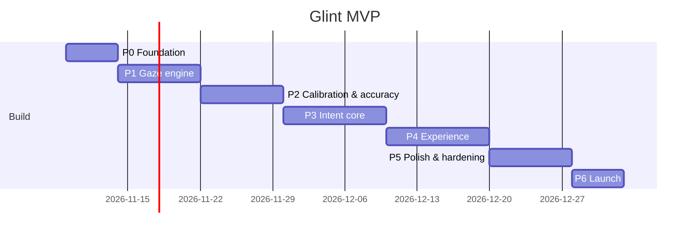

# Glint — Roadmap

> Version: 1.0 · Updated: 2026-11-03 · MVP: 7 phases, ~76 tasks. Each phase ends with a runnable app and testable exit criteria. Tasks are sized for one agent session (≤ ~half a day of human work).

## Overview

| Phase | Goal | Features | Est. effort |
|---|---|---|---|
| P0 — Foundation | Repo, packages, CI (Linux + macOS), menu bar shell, settings store, tokens, signed-build dry run | F-11 (shell), F-14 (pipeline skeleton) | 1 week |
| P1 — Gaze engine (riskiest) | Camera → landmarks → features → events at budget; provider decision; traces | F-02, F-15 | 1.5 weeks |
| P2 — Calibration & accuracy | Calibration game, mapper, Eval Arena, eval gate, silent learning | F-03, F-04, F-15 | 1.5 weeks |
| P3 — Intent core | Snap, double-blink click, glide scroll, overlay, on/off/pause/app rules | F-05, F-06, F-07, F-10, F-13 (overlay) | 2 weeks |
| P4 — Experience | Onboarding, settings, popover, focus-follows-gaze, where-was-I, HUD, metrics | F-01, F-08, F-09, F-11, F-12, F-13 | 2 weeks |
| P5 — Polish & hardening | Full eval, motion, energy, compatibility, security, accessibility, copy | all | 1.5 weeks |
| P6 — Launch | Release pipeline, Sparkle, Homebrew, privacy docs, beta, rollback | F-14 | 1 week |

## Phase 0 — Foundation

**Goal:** an empty-but-real Glint: a menu bar app that launches, persists settings, uses design tokens, passes CI on Linux and macOS, and can be signed and notarized.

**Tasks:**

- [ ] P0.T1 — Verify current stable versions of Xcode, Swift, ONNX Runtime SPM, Sparkle, TelemetryDeck SwiftSDK, Sentry Cocoa, KeyboardShortcuts, swift-snapshot-testing, XcodeGen, SwiftLint, SwiftFormat; update ARCHITECTURE §2 and INSTRUCTIONS §3 in place · refs: ARCHITECTURE §2 · verify: doc diff reviewed; versions recorded in TASK_LOG Decisions
- [ ] P0.T2 — Create the repo skeleton: `project.yml`, `Config/*.xcconfig` (+ `Secrets.example.xcconfig`), `Info.plist` (LSUIElement, camera usage string), `Glint.entitlements` (camera only) + `Glint.entitlements.expected`, `.gitignore` (xcodeproj, build, Secrets.xcconfig), `.gitattributes` (LFS for `Models/**`, `Evals/datasets/**`), `scripts/bootstrap.sh` · refs: INSTRUCTIONS §4, ARCHITECTURE §11–§12 · verify: `scripts/bootstrap.sh && xcodegen generate` succeeds on a clean clone
- [ ] P0.T3 — Create `Packages/GlintCore` (targets `GlintCore`, `GlintCoreTestSupport`, `glint-eval` stub, tests) with `Point/Size/Rect`, `Clock`/`ManualClock`/`SeededGenerator`, and the full `GlintError` catalogue · refs: ARCHITECTURE §3, §5.3, ADR-004 · verify: `swift test --package-path Packages/GlintCore` on macOS and in Docker `swift:6` (Linux)
- [ ] P0.T4 — Create `Packages/GlintKit` (GlintPerception, GlintSystem, GlintServices, GlintUI, GlintRuntime + test targets, with an empty `IntentCoordinator`) and the `App/` target with `GlintApp` (`MenuBarExtra`) and `AppEnvironment` · refs: ARCHITECTURE §3 · verify: `xcodebuild … build` and the app shows a menu bar icon
- [ ] P0.T5 — Add `.swiftlint.yml` (strict, complexity limits, custom `no_magic_thresholds` for `GlintCore/Intent`), `.swiftformat`, `scripts/check-architecture.sh` (import rules §3, network allowlist, banned APIs from G-SEC-01/02/04/05), `scripts/check-licenses.sh`, `scripts/coverage.sh`, `scripts/contrast.py` · refs: EVAL_GUARDRAILS §2, §7.1 · verify: scripts exit 0 on the skeleton and exit 1 on a planted violation (test fixtures in `scripts/tests/`)
- [ ] P0.T6 — Add `.github/workflows/ci.yml` with `core-linux`, `lint`, `app-macos` jobs · refs: TESTING_GUIDE §9 · verify: all three jobs green on the PR
- [ ] P0.T7 — Implement `Settings` (+ nested types, defaults incl. default AppRules), `Settings.validated()`, `SettingsMigrator` v1, `SettingsStore` (atomic writes, corrupt-file backup + defaults, `changes` stream) · refs: ARCHITECTURE §4 Settings, F-11 · verify: `SettingsStoreTests`, `SettingsDefaultsTests` (T-F11-AC1 store part)
- [ ] P0.T8 — Implement design tokens (`GlintColor` + asset catalog light/dark, `GlintFont`, `GlintSpacing`, `GlintRadius`, `GlintShadow`, `GlintMotion`), `GlassSurface` with macOS 26/14 branches and reduce-transparency, and the snapshot test infrastructure · refs: DESIGN_SYSTEM §2–§6, §13 · verify: `swift test --package-path Packages/GlintKit --filter GlintUITests` with token swatch snapshots; `scripts/contrast.py` passes
- [ ] P0.T9 — Build the menu bar glyph (template images for 5 states) and popover skeleton bound to a static `AppModel`, plus a Settings scene with 7 empty tabs · refs: DESIGN_SYSTEM §7, §9.1, §9.4 · verify: snapshot tests for each popover state
- [ ] P0.T10 — Add logging categories (`Logger`), an `OSSignposter` wrapper, and a `Diagnostics` model skeleton · refs: ARCHITECTURE §14 · verify: unit test that `GlintError` logging uses `.public` codes only; arch check for `print(`
- [ ] P0.T11 — Release pipeline skeleton: `scripts/release.sh --dry-run` (archive → export Developer ID → notarytool → staple → DMG) and Sparkle wired with `SPUStandardUpdaterController` against a local test appcast · refs: ARCHITECTURE §13, F-14 · verify: (human-provided Developer ID) a notarized skeleton DMG passes `spctl --assess`; the local appcast update offer appears

**Exit criteria:**

- CI `core-linux`, `lint`, `app-macos` are green on main.
- The app launches as a menu-bar-only app and shows the popover with the static states; settings persist across relaunch (T-F11-AC1 store part).
- A notarized skeleton DMG exists from the dry run (or is recorded as blocked on Q2 with the human).

**Out of this phase:** any camera or ML code; real popover behavior.

## Phase 1 — Gaze engine

**Goal:** on a real Mac, frames become stable face landmarks, features, fixations, and blink events within the latency budget; the landmark provider is decided by data; landmark-only traces can be recorded and replayed deterministically.

**Tasks:**

- [ ] P1.T1 — `CameraService`: device discovery (built-in, external, Continuity), 720p preference, 60→30 fps negotiation, `alwaysDiscardsLateVideoFrames`, interruption handling + restart backoff, `FakeCaptureSession` · refs: F-02, ARCHITECTURE §9 · verify: T-F02-AC5 (`CameraRestartTests`)
- [ ] P1.T2 — Model toolchain: `scripts/models/manifest.json` (pinned URLs + SHA-256 of the MediaPipe sources), `fetch_and_convert.py` (uv, tf2onnx), outputs in `Models/` + `checksums.sha256` (LFS) · refs: ARCHITECTURE §8, §10.1 · verify: `uv run scripts/models/fetch_and_convert.py` is reproducible (same checksums twice)
- [ ] P1.T3 — **Spike:** implement minimal `MediaPipeORTProvider` and `VisionProvider`; measure p95 latency on M1 and landmark jitter on a 2-minute session; confirm no extra entitlements are needed; record the ADR-002 decision with numbers · refs: ADR-002 · verify: spike report in `Evals/reports/spike-providers.md` + ADR updated + TASK_LOG Decisions row
- [ ] P1.T4 — Production providers per ADR-002 + `ModelLoader` (checksum check, warm-up, fallback) + `TraceLandmarkProvider` · refs: ARCHITECTURE §10.1, G-SEC-08 · verify: `ModelLoaderTests` (incl. corrupted model → `MODEL_CHECKSUM_MISMATCH`)
- [ ] P1.T5 — `FeatureExtractor` (eye-corner frames, iris, pose, faceScale, EAR, closure) + `SyntheticEye` · refs: ARCHITECTURE §10.2 · verify: `FeatureExtractorTests` (synthetic round-trip, Linux)
- [ ] P1.T6 — `OneEuroFilter`, `FixationDetector` (I-DT), saccade detection · refs: ARCHITECTURE §10.4 · verify: `OneEuroFilterTests`, `FixationDetectorTests`
- [ ] P1.T7 — `BlinkDetector` + `BlinkGrammar` (double, blink+long, rest closure) · refs: F-02, F-06, ARCHITECTURE §10.4 · verify: T-F02-AC3, T-F06-AC7
- [ ] P1.T8 — `GazeEstimator` (Core) + `GazePipeline` actor (latest-wins, frame-rate controller, pixel-buffer release) · refs: ARCHITECTURE §6.1 · verify: T-F02-AC4, T-F02-AC6 (`GazePipelineRetentionTests`, arch check)
- [ ] P1.T9 — Trace format `glint-trace/v1`, `TraceSchema` validation, `TraceRecorder` (DEBUG) · refs: ARCHITECTURE §10.6, G-SEC-13 · verify: T-F15-AC2
- [ ] P1.T10 — DEBUG gaze dot overlay (temporary 5-point quick mapping for development only), `PerfHarness`, `scripts/perf.sh`, `Glint.tracetemplate` · refs: EVAL_GUARDRAILS §6 · verify: `scripts/perf.sh` prints per-stage p50/p95; record T-F02-AC1 baseline
- [ ] P1.T11 — `glint-eval` v0: load traces, run the pipeline with `ManualClock`, report blink metrics, deterministic output · refs: F-15 · verify: T-F15-AC1

**Exit criteria:**

- On an M1+ Mac, `scripts/perf.sh` shows landmark p95 ≤ 12 ms and frame→sample p95 ≤ 45 ms (T-F02-AC1 baseline recorded).
- ADR-002 is decided with numbers; the fallback provider works when `GLINT_PROVIDER=vision`.
- Replaying the same trace twice gives identical output (T-F15-AC1); traces contain no image data (T-F15-AC2).
- Unplugging and replugging a USB camera recovers within 2 s (T-F02-AC5).

**Out of this phase:** real calibration, AX, overlays beyond the debug dot.

## Phase 2 — Calibration & accuracy

**Goal:** a user can calibrate in ~20 s and get a measured accuracy level. Accuracy is gated in CI by recorded data, and the model improves silently from normal clicks.

**Tasks:**

- [ ] P2.T1 — `GazeMapper` basis expansion, standardization, Cholesky ridge solve, LOO λ selection, uncertainty model · refs: ARCHITECTURE §10.3, ADR-006 · verify: `GazeMapperTests` (SyntheticEye: recovered error < 0.5° noise-free)
- [ ] P2.T2 — `GazeMapperFitter`, `CalibrationProfile`/`ProfileKey`, `ProfileMigrator` v1, `ProfileStore` · refs: ARCHITECTURE §4 · verify: `ProfileStoreTests`, `ProfileMigratorTests`
- [ ] P2.T3 — `CalibrationSession` pure state machine in GlintCore (double-blink start, 9 anchors with settle/samples, face-lost pause, 5-point validation, levels, failed) + `CalibrationCoordinator` in GlintRuntime (persist profile, swap mapper) · refs: F-03, ARCHITECTURE §6.4 · verify: T-F03-AC2, T-F03-AC3, T-F03-AC4, T-F03-AC1 (scripted timing)
- [ ] P2.T4 — Calibration full-screen UI with glass card, calibration glint motion, result/failed states, Esc handling, VoiceOver announcements · refs: DESIGN_SYSTEM §6.2, §9.3 · verify: T-F03-AC5, snapshots for every state
- [ ] P2.T5 — `BlinkSignature` capture during "double-blink to begin"; personalize `BlinkGrammar` thresholds · refs: ARCHITECTURE §4 BlinkSignature · verify: `BlinkSignatureTests`
- [ ] P2.T6 — Eval Arena (DEBUG): consent gate, scenes (standard, dense, jitter, blink drills, long blink, scroll, reading-natural, reading-lines), labeled trace output · refs: F-15, TESTING_GUIDE §4.2 · verify: arena produces schema-valid traces for each scene
- [ ] P2.T7 — **Human-assisted:** record the `Evals/datasets/ci` set (≥ 3 people) and start the v1 protocol (Q3); tune One Euro + fixation parameters with before/after reports; write `baseline.json` · refs: TESTING_GUIDE §4.2, EVAL_GUARDRAILS §9 · verify: report in `Evals/reports/`, human approval noted in TASK_LOG
- [ ] P2.T8 — `glint-eval` metrics: gaze accuracy (deg), blink recall, spontaneous double-blink rate, `--check` thresholds + baseline diff, `--by-subgroup`; enable in CI · refs: EVAL_GUARDRAILS §7.3 · verify: T-F02-AC2; T-F15-AC3
- [ ] P2.T9 — `SilentLearner` (acceptance rules, weights, decay, refit trigger, LOO-guarded swap) · refs: F-04 · verify: T-F04-AC1, T-F04-AC2, T-F04-AC3
- [ ] P2.T10 — `InputMonitor` (global mouse monitors, Glint-tag exclusion, `secondsSinceLastKeyDown`) and wiring to SilentLearner with the settings toggle · refs: F-04, G-SEC-02 · verify: T-F04-AC4, T-F04-AC5
- [ ] P2.T11 — Popover accuracy chip + Recalibrate action; not-calibrated state · refs: F-11, DESIGN_SYSTEM §9.1 · verify: snapshots; `AppModelTests`

**Exit criteria:**

- On a real Mac, calibration completes in ≤ 25 s and shows a level; median error on `Evals/datasets/ci` ≤ 2.2° (CI gate) and the v1 subset recorded so far ≤ 2.0° (T-F02-AC2).
- The `glint-eval --check` job is required in CI and blocks regressions (T-F15-AC3).
- Silent learning improves median error ≥ 25% on the implicit replay (T-F04-AC1).

**Out of this phase:** acting on other apps (AX, clicks, scroll).

## Phase 3 — Intent core

**Goal:** the magic works in real apps. The glint snaps to real targets, a double blink clicks, the bottom zone glides, and the user controls it all with the hotkey, pause, and app rules.

**Tasks:**

- [ ] P3.T1 — `AXService`: element at position, bounded neighborhood scan (≤ 64 elements, ≤ 2 parent hops), role/action/enabled/size filters, `AXSecureTextField` skip, 50 ms messaging timeout, LRU registry, `AXManualAccessibility` once per pid, scroll area + scroll value · refs: F-05, ARCHITECTURE §5.1, §15 · verify: T-F05-AC5, T-F05-AC6 (fake trees)
- [ ] P3.T2 — `WindowService`, `SystemEvents` (lock/unlock/sleep/wake/session/display changes), `PermissionsService` · refs: ARCHITECTURE §5.1 · verify: `SystemEventsTests`, `WindowServiceTests`, `PermissionsServiceTests`
- [ ] P3.T3 — `SnapMachine` (Gaussian scoring, size/dwell priors, hysteresis 25%/120 ms, uncertain margin 15%, aura fallback) · refs: F-05 · verify: T-F05-AC3; glint-eval `arena-standard`/`arena-dense` → T-F05-AC1, T-F05-AC2
- [ ] P3.T4 — `IntentCoordinator`: join the perception stream + AX snapshots (≤ 30 Hz on fixation events) + input activity; keep the previous snapshot on timeout; publish OverlayState · refs: ARCHITECTURE §3, §6.1 · verify: T-F05-AC4, T-F02-AC4 (integration)
- [ ] P3.T5 — Overlay window controller (per gaze display, levels, click-through, `sharingType .none`, AX-hidden) + `GlintRing`, `GazeAura` views + Metal `glintSweep`/`glintBloom` · refs: DESIGN_SYSTEM §2.1, §6, §9.5 · verify: T-F13-AC4 (`OverlayWindowTests`), ring snapshots
- [ ] P3.T6 — `ClickMachine`: lock-stable gate, freeze at blink 1, gaze-return check, cooldown, rate limits, right-click via blink+long · refs: F-06, G-ML-02, G-ML-07 · verify: T-F06-AC1, T-F06-AC4, T-F06-AC5 (unit); glint-eval → T-F06-AC2, T-F06-AC3
- [ ] P3.T7 — `ActuationService`: AXPress/AXShowMenu first, CGEvent click fallback with tag + cursor restore; located pixel scroll stream with phases; **spike ADR-005** routing across Safari/Chrome/Notion/Slack/VS Code · refs: ADR-005, G-SEC-04 · verify: T-F06-AC6, T-F07-AC6 (`ActuationServiceTests` + harness notes)
- [ ] P3.T8 — `ScrollZoneMachine` (zones, dwell, glide sizes, cooldown, at-end, manual suspension) + `EdgeGlow` view + glide easing · refs: F-07, DESIGN_SYSTEM §6.2 · verify: T-F07-AC1 to T-F07-AC5
- [ ] P3.T9 — Overlay states armed/flare/reject/uncertain + right-click variant, reduced-motion and high-contrast variants · refs: DESIGN_SYSTEM §6.2, F-13 · verify: T-F13-AC2, T-F13-AC3 snapshots; `OverlaySequenceTests` (G-ML-03)
- [ ] P3.T10 — `PauseMachine` + `AppRuleGate` (GlintCore) + `TrackingController` (GlintRuntime) + KeyboardShortcuts ⌃⌥G toggle (camera stop ≤ 1 s) + menu-bar-icon pause gesture + away mode (5 fps) + timed pause + lock/sleep camera stop · refs: F-10, G-SEC-10 · verify: T-F10-AC1 to T-F10-AC6
- [ ] P3.T11 — Manual precedence (pointer move hides glint 1.2 s, physical scroll suspends 2 s, mouse down blocks click) + `RateLimitTests` + `ManualPrecedenceTests` · refs: G-ML-07, G-ML-08 · verify: those suites green
- [ ] P3.T12 — Compatibility harness (DEBUG) + first report on the target app list; record per-app scroll fallbacks in `ScrollCompatibility.swift` · refs: TESTING_GUIDE §5.6 · verify: `Evals/reports/compat-<date>.md` committed; T-F05-AC6 manual part

**Exit criteria:**

- Manual QA on a real Mac (TESTING_GUIDE §10, controls + natural-use items): in Safari and Chrome the glint locks links/buttons, a double blink clicks, blink + long blink opens a context menu, and the bottom zone glides without moving the cursor.
- All F-05, F-06, F-07, F-10 automated tests are green; the CI eval gate passes, incl. false clicks ≤ 1 per 30 min on `reading-natural`.
- ⌃⌥G turns the camera off within 1 s; 1Password shows no glint.

**Out of this phase:** onboarding UI, settings UI beyond what's needed to test, telemetry.

## Phase 4 — Experience

**Goal:** a new user goes from download to their first hands-free click in < 90 s through beautiful onboarding, with full settings, focus-follows-gaze, where-was-I, HUD feedback, and opt-in metrics.

**Tasks:**

- [ ] P4.T1 — `OnboardingModel`: step machine, permission polling (500 ms), resume from persisted step, relaunch-required detection · refs: F-01 · verify: T-F01-AC3, T-F01-AC4, T-F01-AC6
- [ ] P4.T2 — Onboarding views: Welcome (hero glint), Camera, Accessibility, Calibrate-preview, with all PermissionCard states and step motion · refs: DESIGN_SYSTEM §9.2 · verify: T-F01-AC1, T-F01-AC2, T-F01-AC5; snapshots
- [ ] P4.T3 — Playground step: practice article, 3 buttons, live checklist using the real IntentEngine; completion → metrics consent card · refs: F-01, DESIGN_SYSTEM §9.2, §9.6 · verify: `PlaygroundModelTests`; manual Journey 1 timing
- [ ] P4.T4 — Popover complete: banners (permission/camera/low light), pause submenu, starting/away/paused states, switch behavior · refs: F-10, F-11, DESIGN_SYSTEM §9.1 · verify: T-F11-AC2; `PopoverUITests`
- [ ] P4.T5 — Settings General, Gestures, Scrolling tabs with live-bound SettingsModel, scrolling mini-preview, not-calibrated banner · refs: F-11, DESIGN_SYSTEM §9.4 · verify: T-F11-AC1, T-F11-AC4
- [ ] P4.T6 — Settings Apps tab (rules table, add current app, app picker, reset to defaults, empty state) + Privacy tab (silent learning toggle/reset, delete all data with confirm) · refs: F-10, F-11 · verify: T-F11-AC3 (`DataDeletionTests`, `SettingsUITests`)
- [ ] P4.T7 — Advanced tab (diagnostics table, debug dot, Demo capture mode, export diagnostics, run setup again) + About (Check for Updates) + launch at login via `SMAppService` · refs: F-11, G-SEC-14 · verify: T-F11-AC6, `DiagnosticsExportTests`; T-F11-AC5 manual
- [ ] P4.T8 — `FocusDwellMachine` + `WindowService.raise` + window flash · refs: F-08 · verify: T-F08-AC1 to T-F08-AC4
- [ ] P4.T9 — `ReadingTracker` (reading-mode detection, line rect via AX line bounds or band, attention break, return marker rules) + `LineMarker` view · refs: F-09 · verify: T-F09-AC1 to T-F09-AC4
- [ ] P4.T10 — `HUDCenter` + `HUDCapsule` + catalogue (DESIGN_SYSTEM §9.7), incl. the accuracy-dip nudge from rising validation residuals; VoiceOver announcements · refs: DESIGN_SYSTEM §9.7 · verify: `HUDCenterTests` (coalescing, flare wait), snapshots
- [ ] P4.T11 — Metrics: `TelemetrySignal` schema, `MetricsAggregator`, `MetricsQueue` (7-day cap), `TelemetryClient` (TelemetryDeck), `CrashReporter` (Sentry, scrubbed), consent card, PayloadViewer · refs: F-12, ARCHITECTURE §8, G-SEC-05/06 · verify: T-F12-AC1 to T-F12-AC4
- [ ] P4.T12 — Accessibility audit of onboarding/popover/settings (`performAccessibilityAudit`), keyboard traversal, VoiceOver labels · refs: F-13, DESIGN_SYSTEM §11 · verify: T-F13-AC1

**Exit criteria:**

- On a fresh macOS user account, Journey 1 completes with a first hands-free click in < 90 s (timed, recorded in TASK_LOG).
- All F-01, F-08, F-09, F-11, F-12, F-13 automated tests are green; `performAccessibilityAudit` reports 0 issues.
- With metrics off, `NetworkEgressTests` shows no non-Sparkle traffic (T-F12-AC1).

**Out of this phase:** release automation, final assets.

## Phase 5 — Polish & Hardening

**Goal:** Glint feels finished and trustworthy on real hardware, in real apps, for diverse users.

**Tasks:**

- [ ] P5.T1 — Run the full `v1` eval with `--by-subgroup`; propose threshold/constant tuning with before/after reports; update the baseline with human approval · refs: EVAL_GUARDRAILS §7.3, G-ML-09 · verify: all blocking thresholds met; disparity ≤ 5 pp
- [ ] P5.T2 — Motion pass at 60/120 Hz: choreography rules, flare/HUD sequencing, Metal HUD frame times, reduced-motion completeness · refs: DESIGN_SYSTEM §6 · verify: 0 dropped frames in an Instruments run; updated snapshots
- [ ] P5.T3 — Energy & performance pass: degrade ladder, Low Power Mode, away mode, memory · refs: G-COST-01…07 · verify: `scripts/perf.sh` evidence for T-F02-AC1; Activity Monitor "Low"
- [ ] P5.T4 — Failure-mode pass: low light, backlight, glasses glare, face lost mid-click, camera unplug, AX-degraded apps, corrupt settings/profile files, permission revoked at runtime · refs: EVAL_GUARDRAILS §5 · verify: TESTING_GUIDE §10 items; new regression tests for every bug found
- [ ] P5.T5 — Compatibility fixes: re-run the harness on all target apps, fix scroll/press fallbacks, Electron/Chromium handling · refs: TESTING_GUIDE §5.6 · verify: compat report with all target apps passing or documented as aura/excluded
- [ ] P5.T6 — Security review G-SEC-01…14 with evidence; extend `check-architecture.sh` for anything found; entitlement diff · refs: EVAL_GUARDRAILS §2 · verify: checklist recorded in TASK_LOG with links
- [ ] P5.T7 — Accessibility pass: VoiceOver, keyboard, Reduce Motion, Increase Contrast, Reduce Transparency, Differentiate Without Color · refs: F-13, DESIGN_SYSTEM §11 · verify: TESTING_GUIDE §10 a11y items; T-F13-AC1…AC4 re-run
- [ ] P5.T8 — Copy and asset pass: String Catalog completeness, DESIGN_SYSTEM §10 voice, final app icon (Icon Composer, light/dark/tinted) and menu bar glyphs · refs: DESIGN_SYSTEM §7, §10 · verify: copy review checklist; snapshots
- [ ] P5.T9 — UX rubric session with the human on the hero flows; fix every item scored < 4 · refs: EVAL_GUARDRAILS §7.2 · verify: rubric scores recorded; average ≥ 4.0

**Exit criteria:**

- Release DoD items 1–5 in EVAL_GUARDRAILS §1 pass (except signing/notarization, which happens in P6).
- UX rubric average ≥ 4.0 per hero flow, no item < 3.
- Zero open P0 bugs.

## Phase 6 — Launch

**Goal:** a signed, notarized, auto-updating Glint is publicly downloadable, with privacy docs, a beta-validated build, and a rehearsed rollback.

**Tasks:**

- [ ] P6.T1 — Complete `.github/workflows/release.yml`: cert import, archive, export, notarize + staple app and DMG (branded background), Sparkle zip, `generate_appcast`, GitHub Release, `spctl` + entitlement-diff post-checks · refs: ARCHITECTURE §13, G-SEC-07 · verify: T-F14-AC1 on a `v0.9.0-beta.1` tag
- [ ] P6.T2 — Production Sparkle keys + feed URL (Q1 decides the repo); update vN→vN+1 and tamper tests · refs: F-14, G-SEC-09 · verify: T-F14-AC2, T-F14-AC3
- [ ] P6.T3 — Homebrew tap repo + `Casks/glint.rb` + release-job bump step · refs: F-14 · verify: T-F14-AC4
- [ ] P6.T4 — Production TelemetryDeck app + Sentry project, `Secrets.xcconfig` in CI, dashboards (activation funnel, daily actions, calibration buckets, false-click proxy, latency), alerts · refs: PRD §7, ARCHITECTURE §14 · verify: an opted-in test install shows signals in dashboards within 24 h
- [ ] P6.T5 — `PRIVACY.md`, `README.md` (install, permissions explained, privacy, troubleshooting, uninstall), acknowledgements/licenses screen content · refs: EVAL_GUARDRAILS §8 · verify: human review
- [ ] P6.T6 — Private beta (15–20 users, mixed Macs/glasses/lighting) via the beta appcast; collect rubric + issues; fix blockers · refs: PRD §7 · verify: crash-free ≥ 99.5% over the beta; no open P0 bugs
- [ ] P6.T7 — Rollback rehearsal with `scripts/rollback.sh` on the beta channel; full Release DoD checklist · refs: ARCHITECTURE §13, EVAL_GUARDRAILS §1 · verify: rehearsal notes in TASK_LOG; DoD checklist complete
- [ ] P6.T8 — Launch kit: record the demo videos using Demo capture mode, the README GIF, and the 1.0.0 release notes; human publishes the `v1.0.0` tag · refs: F-11.AC6 · verify: v1.0.0 release live; Homebrew install works

**Exit criteria:**

- `v1.0.0` is published: notarized DMG, Sparkle appcast, Homebrew cask; `brew install --cask` and DMG install both work on a clean Mac.
- Updating from the beta to 1.0.0 preserves settings and permissions.
- Release DoD (EVAL_GUARDRAILS §1) is fully checked with evidence.

## Later / Backlog

| ID | Item | Notes |
|---|---|---|
| B-01 | Multi-monitor gaze | Per-display calibration, cross-display geometry |
| B-02 | Full hands-free mode | Gaze typing keyboard, drag-and-drop, dwell click fallback |
| B-03 | Custom gaze model research track | Distill an appearance-based model from consented data; replaces/augments ridge mapper |
| B-04 | Key-hold-to-click gesture | Look + hold a modifier as an alternative to the double blink |
| B-05 | Multiple profiles per camera×display | e.g. glasses on/off, auto-detected |
| B-06 | Marketing website | Landing page, docs, changelog |
| B-07 | Localization | Additional languages via the String Catalog |
| B-08 | IR eye-tracker provider | Implement `LandmarkProviding`-like `GazeProviding` for Tobii |
| B-09 | Open-source release | Depends on Q1 |
| B-10 | Paid tier / licensing | Business model decided after traction |

## Feature → Phase Map

| Feature | Phase | Tasks |
|---|---|---|
| F-01 Onboarding & permissions | P4 | P4.T1, P4.T2, P4.T3 |
| F-02 Gaze engine | P1 (+P5) | P1.T1, P1.T3, P1.T4, P1.T5, P1.T6, P1.T7, P1.T8, P1.T10, P2.T8, P5.T3 |
| F-03 Calibration game | P2 | P2.T1, P2.T2, P2.T3, P2.T4, P2.T5 |
| F-04 Silent learning | P2 | P2.T9, P2.T10 |
| F-05 Magnetic snap & glint | P3 | P3.T1, P3.T3, P3.T4, P3.T5, P3.T12 |
| F-06 Double-blink click | P1, P3 | P1.T7, P3.T6, P3.T7, P3.T9 |
| F-07 Glide scroll | P3 | P3.T7, P3.T8 |
| F-08 Gaze-to-focus | P4 | P4.T8 |
| F-09 Where was I | P4 | P4.T9 |
| F-10 Activation & safety | P3, P4 | P3.T10, P3.T11, P4.T4, P4.T6 |
| F-11 Menu bar & settings | P0, P2, P4 | P0.T7, P0.T9, P2.T11, P4.T4, P4.T5, P4.T6, P4.T7 |
| F-12 Opt-in metrics | P4, P6 | P4.T11, P6.T4 |
| F-13 Accessibility foundations | P3, P4, P5 | P3.T5, P3.T9, P4.T12, P5.T7 |
| F-14 Distribution & updates | P0, P6 | P0.T11, P6.T1, P6.T2, P6.T3 |
| F-15 Eval Arena & replay | P1, P2 | P1.T9, P1.T11, P2.T6, P2.T7, P2.T8 |
